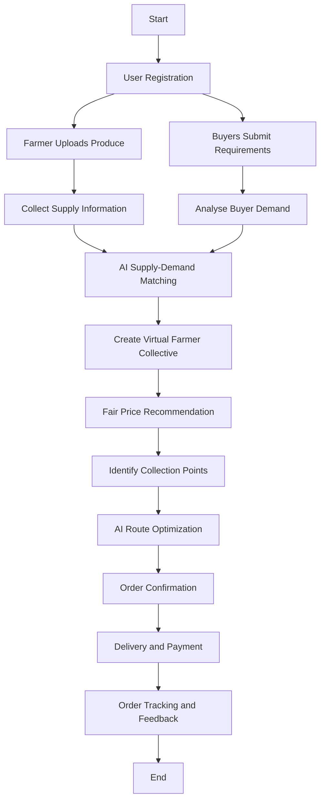

# SMART INDIA HACKATHON WORKSHOP

**Date:** 24-11-2026
**Reference Number:** 26011212
**Name:** Mananiyaa.M

## Problem Title

**SIH 26033: Multiple intermediaries reduce farmers' earnings and increase consumer prices.**

## Problem Creator's Organization

Ministry of Consumer Affairs, Food & Public Distribution

## Theme

Agriculture, FoodTech & Rural Development

---

# 1. Proposed Solution

### Project Title: HarvestCircle – The Demand-Pooled Agriculture Network

**Tagline:** Connecting Farmers, Combining Demand, Simplifying Distribution.

### 1.1 Detailed Explanation of the Proposed Solution

HarvestCircle is an AI-powered agricultural supply chain platform designed to connect farmers, Farmer Producer Organizations (FPOs), consumers, retailers, supermarkets and bulk buyers through a single digital network.

Unlike traditional agricultural marketplaces, HarvestCircle introduces a **Virtual Farmer Collective**, where multiple small-scale farmers can combine their available produce to fulfil the requirements of multiple buyers.

The platform follows a demand-first approach, where buyer requirements are collected and analysed before coordinating the supply and transportation of agricultural products.

Its major features include:

**1. Virtual Farmer Collective:**

- Connects nearby farmers who cultivate similar crops.
- Combines their available produce into larger supply batches.
- Enables small-scale farmers to fulfil bulk orders collectively.
- Allows farmers to retain control over their individual produce and selling prices.

**2. Reverse Demand Matching:**

- Buyers can post their required crop, quantity, quality and delivery location.
- The system identifies farmers who can fulfil these requirements.
- Multiple buyer requirements are combined into demand clusters.
- Farmers receive suitable order opportunities based on their availability.

**3. AI-Based Fair Price Recommendation:**

- Analyses available agricultural market prices, demand and supply.
- Suggests suitable selling prices to farmers.
- Displays the farmer's selling price, transportation cost and other applicable charges separately.
- Helps buyers understand the actual cost of purchasing produce.

**4. Smart Collection Point Allocation:**

- Identifies convenient collection points for nearby farmers.
- Combines agricultural products from multiple farms at designated locations.
- Reduces repeated transportation trips.

**5. AI-Based Shared Route Optimization:**

- Groups orders based on their delivery locations.
- Suggests efficient delivery routes.
- Reduces unnecessary travel distance and transportation expenses.
- Supports multiple deliveries through a coordinated distribution network.

**6. Digital Produce Passport:**

- Assigns a unique digital identification number to each produce batch.
- Records farmer details, crop type, harvest date, quantity and quality information.
- Allows buyers to check the origin and basic history of their purchased produce.

### 1.2 How It Addresses the Problem

| Existing problem                    | Proposed solution                                     |
| ----------------------------------- | ----------------------------------------------------- |
| Multiple intermediaries             | Direct digital connection between farmers and buyers  |
| Low earnings for farmers            | Collective bulk orders and fair price recommendations |
| High consumer prices                | Reduced unnecessary commissions and markups           |
| Difficulty selling small quantities | Virtual Farmer Collective                             |
| High transportation expenses        | Shared collection and optimized delivery              |
| Uncertain market demand             | AI-based demand forecasting                           |
| Lack of product transparency        | Digital Produce Passport                              |

### 1.3 Innovation and Uniqueness of the Solution

The major innovation of HarvestCircle is the combination of **Virtual Farmer Collectives and Reverse Demand Matching**.

Instead of expecting individual farmers to find buyers independently, the platform creates a coordinated agricultural network.

Its unique features are:

- **Virtual Farmer Collective:** Combines produce from multiple small-scale farmers without requiring a physical cooperative.
- **Demand Before Distribution:** Identifies buyer requirements before coordinating supply and transportation.
- **Reverse Demand Matching:** Matches buyer requirements with available farmers instead of making buyers search through individual listings.
- **Shared Collection Points:** Coordinates the collection of produce from nearby farms.
- **Digital Produce Passport:** Improves transparency by recording the origin and movement of each produce batch.
- **AI-Powered Distribution:** Connects demand forecasting, supply matching and route optimization into one system.

This makes HarvestCircle more than an ordinary agricultural shopping application. It functions as a coordinated digital supply chain network.

---

# 2. Technical Approach

### 2.1 Technologies to Be Used

| Component               | Technology                       |
| ----------------------- | -------------------------------- |
| Frontend                | HTML, CSS, JavaScript            |
| Backend                 | Python Django                    |
| Database                | PostgreSQL / SQLite              |
| AI and Machine Learning | Python, Scikit-learn             |
| Demand Forecasting      | Machine Learning models          |
| Price Recommendation    | Historical market price analysis |
| Route Optimization      | OpenStreetMap, Graph Algorithms  |
| Location Services       | Maps API                         |
| Digital Payment         | UPI Payment Integration          |
| Version Control         | Git and GitHub                   |

### 2.2 Methodology and Process for Implementation

**Step 1: User Registration**

Farmers, consumers, retailers and bulk buyers register on the platform with their basic details and location.

**Step 2: Agricultural Supply Listing**

Farmers upload crop details, available quantities, expected harvest dates and preferred selling prices.

**Step 3: Buyer Demand Collection**

Consumers and bulk buyers enter their requirements, including crop type, quantity, quality and delivery location.

**Step 4: AI-Based Demand Analysis**

The system analyses buyer requirements and historical demand data to identify common crop requirements in nearby locations.

**Step 5: Virtual Farmer Collective Formation**

The system groups nearby farmers who can collectively fulfil the identified demand.

**Step 6: Price Recommendation**

The AI module analyses available market prices, demand and supply to suggest reasonable prices.

**Step 7: Collection Point Identification**

The system identifies suitable collection points based on farmer locations and order requirements.

**Step 8: Route Optimization**

The logistics module groups deliveries and calculates efficient routes to reduce transportation expenses.

**Step 9: Order Completion and Payment**

The produce is delivered to buyers, and payments are processed through supported digital payment methods.

**Step 10: Tracking and Feedback**

Farmers and buyers can monitor order status, view transaction information and provide feedback.

### 2.3 Technical Flowchart

### 2.4 Prototype Development Plan

The initial prototype will contain:

1. Farmer registration and login page.
2. Farmer produce listing dashboard.
3. Buyer requirement submission page.
4. Supply and demand matching module.
5. Basic price recommendation module.
6. Collection point and route visualization.
7. Order tracking dashboard.

The prototype can initially use sample agricultural datasets. Machine learning and logistics modules can be improved using real-world data during further development.

---

# 3. Feasibility and Viability

### 3.1 Analysis of the Feasibility of the Idea

HarvestCircle is technically and economically feasible because it uses existing web development technologies, open-source tools and digital payment services.

- Python Django can be used to develop the complete web platform.
- PostgreSQL can store farmer, buyer, crop and order information.
- Machine learning models can analyse historical demand and agricultural price data.
- OpenStreetMap can provide geographical information for identifying collection points and delivery routes.
- Digital payment integration can simplify transactions between farmers and buyers.

The project can initially be developed as a web-based prototype and tested in a small agricultural community before expanding to larger regions.

### 3.2 Potential Challenges and Risks

| Potential challenge                     | Possible solution                              |
| --------------------------------------- | ---------------------------------------------- |
| Limited digital knowledge among farmers | Simple interface and regional language support |
| Unreliable internet connectivity        | Low-data and offline-friendly features         |
| Inaccurate demand predictions           | Regular model updates using actual order data  |
| Inconsistent produce quality            | Quality verification and batch identification  |
| Difficulty coordinating farmers         | Location-based grouping and notifications      |
| Transportation availability             | Partnerships with local transport providers    |
| Price fluctuations                      | Regular updates from agricultural market data  |
| Payment-related difficulties            | Integration with trusted payment providers     |

### 3.3 Strategies for Overcoming These Challenges

- Provide a simple mobile-friendly interface.
- Support regional languages such as Tamil, Telugu and Hindi.
- Use reliable agricultural market datasets for price analysis.
- Introduce basic quality verification before confirming bulk orders.
- Collaborate with FPOs and local agricultural organizations.
- Start implementation in a limited geographical area.
- Continuously improve the AI models using actual transaction and delivery records.

---

# 4. Impact and Benefits

### 4.1 Potential Impact on the Target Audience

**Farmers:**

- Better access to consumers and bulk buyers.
- Improved opportunities to sell agricultural produce.
- Reduced dependence on unnecessary intermediaries.
- Better visibility of market demand and prices.

**Consumers:**

- Access to fresh agricultural products.
- More transparent pricing.
- Reduced additional distribution costs.

**Retailers and Bulk Buyers:**

- Easier access to multiple farmers.
- Simplified bulk purchasing.
- More organized agricultural supply.

**Rural Communities:**

- Improved digital connectivity.
- Better agricultural market participation.
- Opportunities for local transport providers.

### 4.2 Benefits of the Solution

**Social Benefits:**

- Supports small and marginal farmers.
- Encourages digital participation in agriculture.
- Strengthens connections between rural producers and urban consumers.

**Economic Benefits:**

- Reduces unnecessary intermediary commissions.
- Improves farmers' market access.
- Helps reduce transportation expenses through shared deliveries.
- Encourages transparent agricultural transactions.

**Environmental Benefits:**

- Reduces unnecessary transportation trips.
- Encourages demand-based harvesting.
- Helps minimize agricultural produce wastage.
- Supports efficient distribution of available resources.

---

# 5. Research and References

The following resources will be used for research, agricultural data collection and technical development.

1. **e-NAM – National Agriculture Market:** [https://www.enam.gov.in/](https://www.enam.gov.in/)
   Reference for digital agricultural trading and connecting agricultural markets.

2. **AGMARKNET:** [https://agmarknet.gov.in/](https://agmarknet.gov.in/)
   Reference for agricultural commodity market prices and market information.

3. **ONDC – Open Network for Digital Commerce:** [https://www.ondc.org/](https://www.ondc.org/)
   Reference for digital commerce networks and connecting buyers and sellers.

4. **Data.gov.in:** [https://www.data.gov.in/](https://www.data.gov.in/)
   Source for publicly available government datasets.

5. **OpenStreetMap:** [https://www.openstreetmap.org/](https://www.openstreetmap.org/)
   Reference for geographical information and route planning.

6. **Scikit-learn:** [https://scikit-learn.org/](https://scikit-learn.org/)
   Reference for implementing machine learning and demand forecasting.

7. **Django Documentation:** [https://docs.djangoproject.com/](https://docs.djangoproject.com/)
   Reference for backend development.

---

## Conclusion

HarvestCircle aims to transform the traditional agricultural supply chain into a transparent, demand-driven and technology-enabled network.

By introducing Virtual Farmer Collectives, Reverse Demand Matching, AI-based price recommendations, shared collection points and route optimization, the platform addresses the challenges faced by both farmers and consumers.

The proposed solution empowers small-scale farmers to participate in bulk agricultural markets while helping consumers access agricultural products at more reasonable prices.

**HarvestCircle – Together We Grow, Together We Deliver.**
